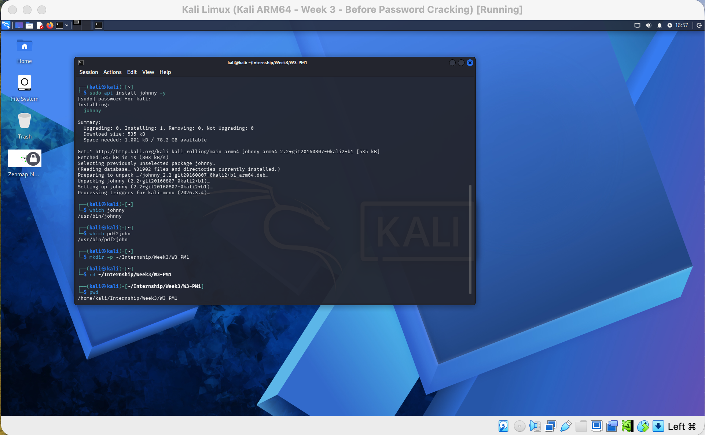
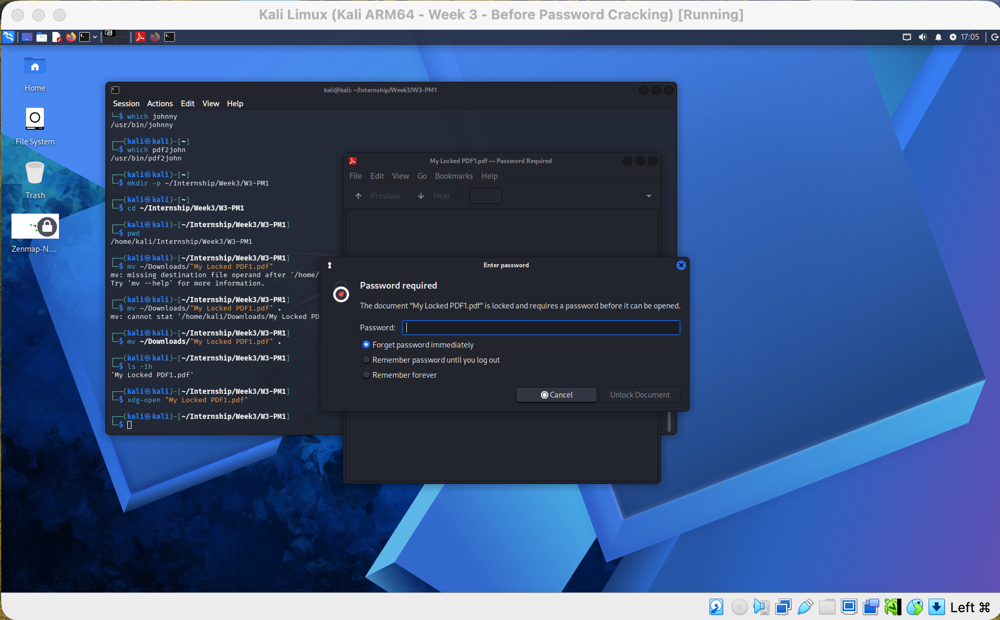
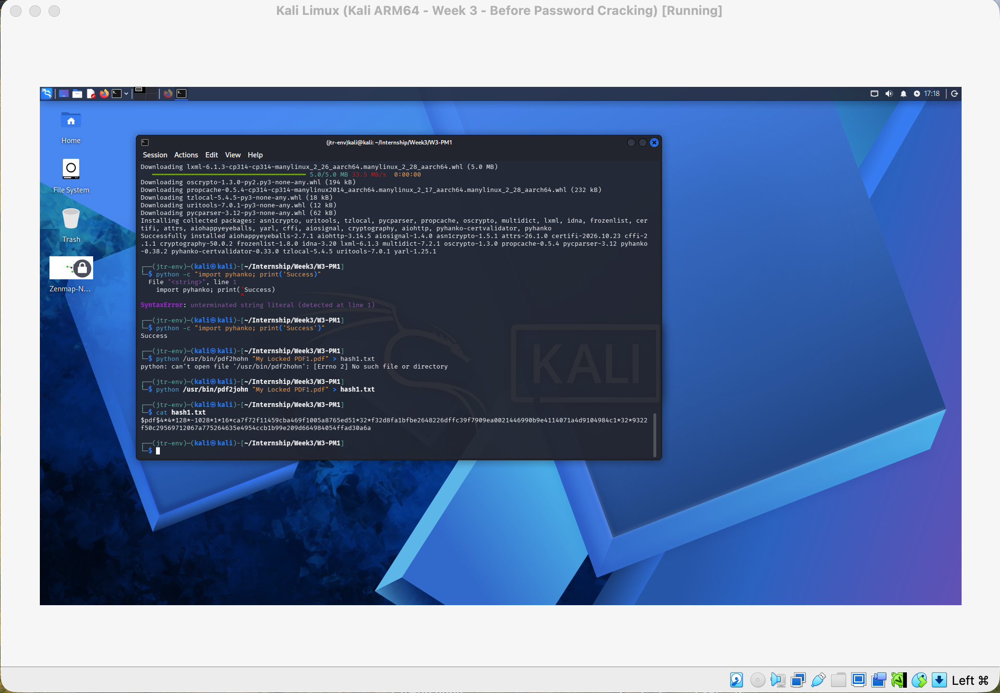
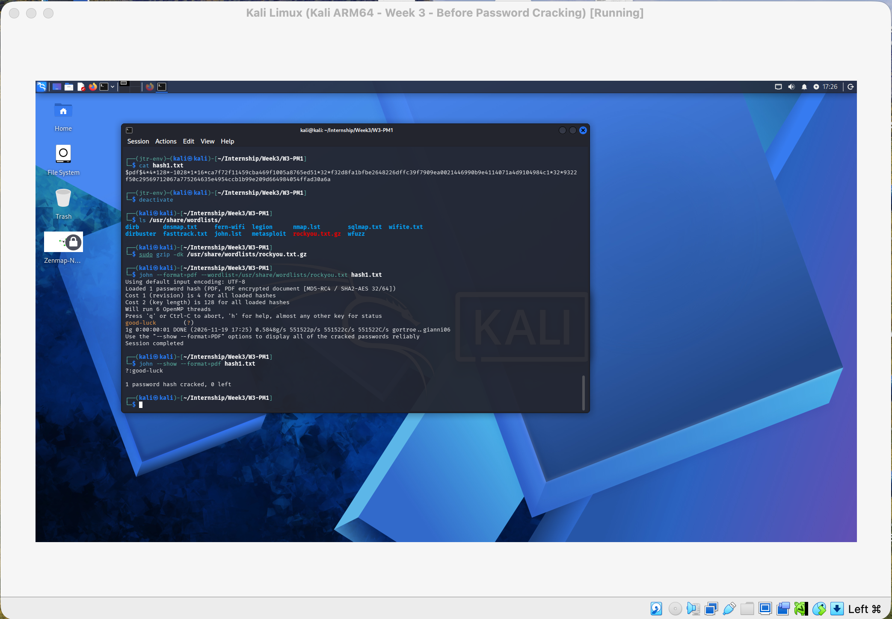
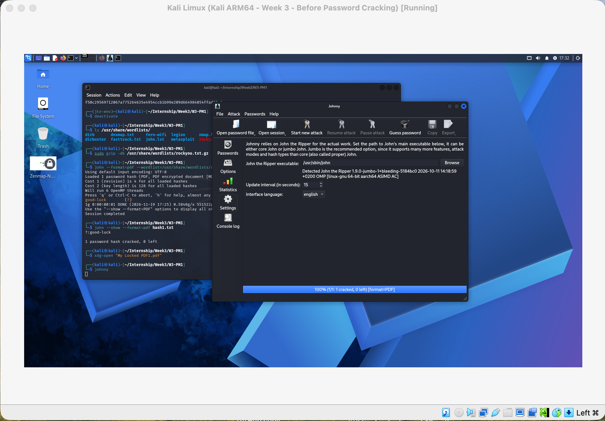
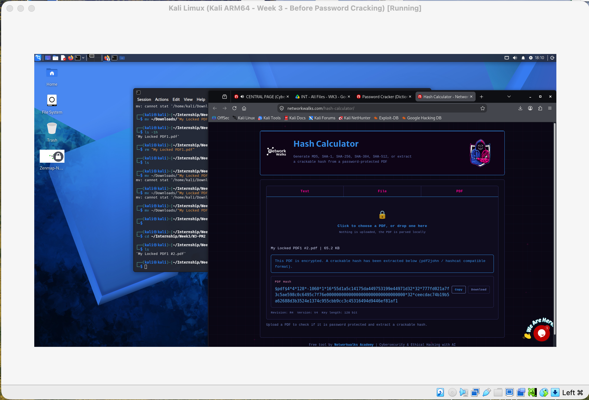
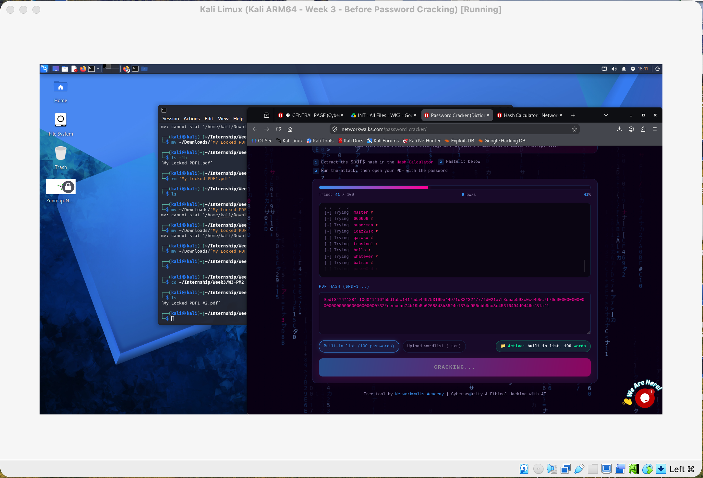
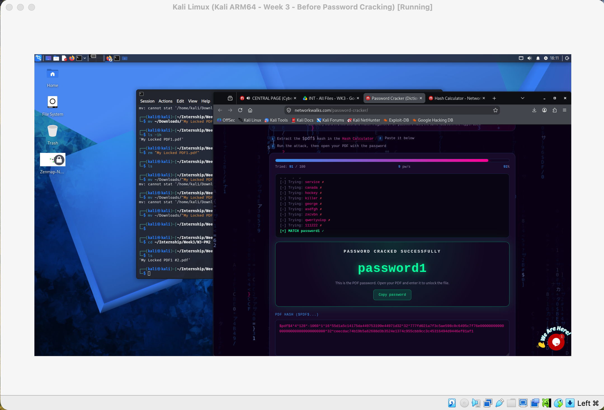

# NETWORKWALKS-B084-WK3-PASSWORD-CRACKING-AND-SECURITY-ASSESSMENT

# Password Cracking and Security Assessment

## Cybersecurity & Ethical Hacking Internship – Week 3

**Intern:** Aamir Taariq  
**Organization:** NetworkWalks  
**Batch ID:** B084  
**Completion Date:** November 19, 2026  
**Environment:** Kali Linux ARM64 | Oracle VirtualBox  

---

## Project Overview

This repository documents the completion of Week 3 of my
Cybersecurity and Ethical Hacking internship with NetworkWalks.

The projects focused on password recovery, hash extraction,
dictionary attacks, and evaluating password security using
command-line, graphical, and browser-based security tools.

All activities were conducted in an authorized training
environment using files provided by NetworkWalks.

## Project Objectives

- Understand password hashing and encryption.
- Extract password-verification data from encrypted PDFs.
- Conduct authorized dictionary attacks.
- Evaluate weak and commonly used passwords.
- Verify recovered passwords.
- Document findings and security recommendations.

## Tools and Technologies

| Tool | Purpose |
|---|---|
| Kali Linux | Security testing environment |
| Oracle VirtualBox | Virtualization |
| John the Ripper | Password recovery |
| Johnny | Graphical interface for JTR |
| PDF2John | PDF hash extraction |
| Python | Dependency management |
| pyHanko | PDF processing |
| RockYou | Password dictionary |
| NetworkWalks Hash Calculator | Browser-based hash extraction |
| NetworkWalks Password Cracker | Dictionary-based password recovery |

---

# Project 1: Password Cracking with John the Ripper

## Step 1: Environment Preparation

Verified the installation of John the Ripper, Johnny,
and PDF2John within Kali Linux.

## Step 2: Verify Password Protection

Opened the supplied PDF and confirmed that the document
required a password before its contents could be accessed.

## Step 3: PDF Hash Extraction

Configured a Python virtual environment and installed
pyHanko to resolve missing dependencies.

Successfully extracted the PDF password-verification
data using PDF2John.

## Step 4: Dictionary Attack

Performed an authorized dictionary attack using John
the Ripper and the RockYou wordlist.

The password was successfully recovered in approximately
one second.

## Step 5: Password Validation and Flag Capture

Used the recovered password to unlock the encrypted PDF
and successfully capture the designated flag.

## Step 6: Johnny Verification

Configured Johnny to use the John the Ripper executable.

Johnny successfully recognized the previously recovered
password, confirming the password recovery results.

---

# Project 2: Password Cracking with NetworkWalks Tools

## Step 1: Browser-Based Hash Extraction

Used the NetworkWalks Hash Calculator to extract
password-verification data from the supplied PDF.

## Step 2: Dictionary Attack

Imported the extracted PDF hash into the NetworkWalks
Password Cracker and performed a dictionary attack.

Evaluated the limitations of the built-in password
dictionary.

## Step 3: Password Recovery

Successfully recovered the password using the
NetworkWalks Password Cracker.

## Step 4: Flag Capture

Validated the recovered password by unlocking the
protected PDF and capturing the designated flag.

---

## Project Results

| Assessment | Result |
|---|---|
| JTR Password Recovery | Successful |
| Johnny Password Verification | Successful |
| NetworkWalks Hash Extraction | Successful |
| NetworkWalks Password Recovery | Successful |
| PDF Password Validation | Successful |
| Flag Capture | Successful |

## Security Findings

The assessments demonstrated that commonly used passwords
are vulnerable to dictionary-based password recovery.

Even encrypted documents can become accessible when
protected by predictable passwords.

## Security Recommendations

- Use long, unique, randomly generated passwords.
- Avoid commonly used passwords and predictable phrases.
- Use a reputable password manager.
- Screen account passwords against compromised password lists.
- Implement phishing-resistant MFA for online accounts.
- Use modern encryption and password derivation mechanisms.
- Conduct authorized password security assessments regularly.

## Skills Developed

- Password security assessment
- Ethical hacking
- Cryptography fundamentals
- Hash extraction
- Dictionary attack analysis
- Linux administration
- Python virtual environments
- Security documentation
- Credential and authentication security

## Ethical Disclaimer

All testing documented in this repository was conducted
with authorization as part of the NetworkWalks
Cybersecurity and Ethical Hacking internship.

This repository is intended for educational and
professional portfolio purposes.

## Acknowledgments

Thank you to NetworkWalks for providing the training
environment and hands-on cybersecurity projects.
